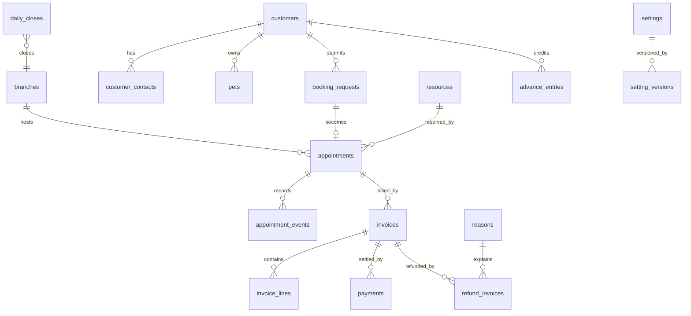

# Pet Grooming BD — Schema (D5)

Status: **Draft for G0 review.** Built from [PRD.md](PRD.md), [AppFlow.md](AppFlow.md) and [TRD.md](TRD.md). The Architecture Revision Note's entity table (its section 6) was not available. The entity list below is therefore a **proposal derived from rules the plan states**, and every column the plan does not define is left open. Nothing here is a migration; migrations arrive milestone by milestone, never all at once.

## Conventions

- Money is `DECIMAL(12,2)` (or integer minor units with brick/money). It is never float, and it travels as a decimal string in JSON.
- Ledger and snapshot rows are never updated or deleted. Corrections are linked documents.
- Records edited by two staff at once carry a `version` column for the optimistic check.
- Customer identity is global. Branch access is a separate concern (scope plus policy), so customers carry no branch owner.
- Booking, invoice, payment, refund and notification states live in separate columns or tables, never in one status field.
- Open column lists are written **Unset** until the Note or an owner decision defines them.

## Entities

| Entity | Milestone | Purpose | Constraints stated by the plan |
|---|---|---|---|
| `branches` | M1 | The two launch branches, seeded | Seeded, not user-created at launch |
| `users` | M1 | The six individual staff accounts (2 admins, 4 staff) | One account per person; staff MFA; role mapping Unset |
| `customers` | M1 | Global customer identity | A public request never overwrites an existing profile |
| `customer_contacts` | M1 | Verified phone and other contacts | Shared phone or household policy Unset; verification state kept per contact |
| `pets` | M1 | Pets belonging to customers | Multi-pet supported; care alerts visible to the assigned groomer |
| `services` | M1 | Service and package catalog (dog, cat, rabbit) | Content and prices owned by the website content document |
| `price_rules` | M1 | Price rules with precedence | Precedence order Unset; a quote and an invoice snapshot the price they used |
| `settings` | M1 | Typed admin settings | Every value starts Unset; an Unset value blocks the operation |
| `setting_versions` | M1 | History of each setting | Append-only; a change never alters a confirmed booking or issued document |
| `reasons` | M1 | Refund reason catalog | Active and archived; archived labels stay visible on old documents |
| `resources` | M2 | Groomers and other exclusive resources | The lock target is a concrete resource row or a resource-day row |
| `booking_requests` | M2 | Public requests | Reserves nothing; holds are separate from confirmed reservations |
| `appointments` | M2 | Confirmed reservations | `version` column; half-open `[start, end)` overlap checked inside a transaction with `lockForUpdate()` on the parent row |
| `appointment_events` | M2 | Reschedule, check-in, completion and incident events | Append-only; a reschedule is its own event |
| `idempotency_keys` | M2 | Safe retries for booking and payment mutations | Durable table; unique key; request hash; stored response; same key with different payload returns 422 |
| `invoices` | M3 | Issued invoices | Issued amounts never edited; void and correction are linked documents; tax snapshot stored |
| `invoice_lines` | M3 | Lines of an invoice | Line, customer, price and tax snapshot are immutable |
| `invoice_sequences` | M3 | Invoice number source | Number taken from a locked sequence row at issue time, not AUTO_INCREMENT; gap-free rule and Mushak format Unset |
| `payments` | M3 | Collections: cash, bKash, Nagad | Split and partial supported; receipt ID; reversal is a linked row |
| `advance_entries` | M3 | Customer advance ledger | append-only; available credit derived from posted entries and active reservations; linked reversals; consistent lock order |
| `refund_invoices` | M3 | Refund documents | State draft, pending payout, completed, failed, void; active reason id and label snapshot required; pending reserves the amount; payout posted once |
| `daily_closes` | M3 | Cashier close | Expected versus declared per method, with a reason for any difference |
| `outbox_messages` | M2 | Critical SMS and other outbound messages | Written in the same transaction as the business change (ADR-0004); the relay in M5 retries failures |

Supporting tables from packages (roles and permissions, activity log, queue and cache tables) are introduced by the package that owns them, after S-1 settles versions.

## Relationships (proposed)

## Indexes and queries

Index design needs the real query list from the UI and API work and is **Unset**. Known requirements: overlap lookup per resource, customer lookup by verified phone, and daily close totals per branch and method.

## Not in the MVP

The customer portal tables, including `customer_accounts`, are not built. Gate 3 covers ownership policy and public endpoints only. Inventory, membership and a payment gateway have no tables. Dev data is fake, with no real customer data.

## Open items

- Column lists for every entity: the Note's entity table or an owner decision.
- Price rule precedence, tax classes, and numbering gap rules: owner and accountant decisions.
- Data ownership and retention per entity: accountant decision (record retention).
- Whether branch is stored on appointments, invoices and payments directly, or derived: not stated in the sources.
